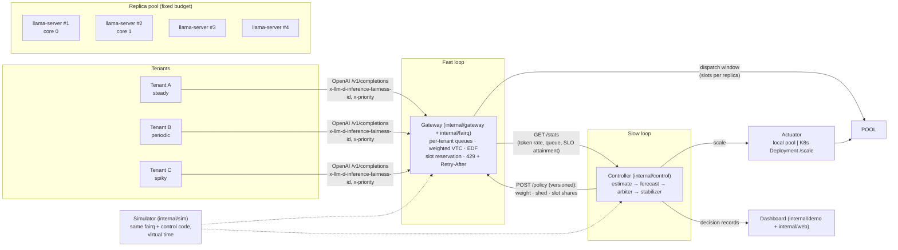

# TenantScaler

**Per-tenant guaranteed shares for a shared LLM replica pool: an autoscaler that decides _whose_ requests get the scarce replicas, coupled to a token-fair gateway.**

Several teams share one LLM served by one fixed pool of replicas, and each team has a latency SLO. When one team's traffic spikes, the others miss their SLO although their own traffic did not change: the *noisy neighbour*. Per-workload autoscalers such as HPA and KEDA can grow the pool, but they cannot decide whose requests the replicas serve. Once the budget is reached, everyone degrades together.

TenantScaler runs two coupled loops:

- **Slow loop: the controller, every 10–15 s.** It estimates each tenant's demand from its weighted token rate (input + 2 × output tokens), optionally raised by a Holt-Winters forecast. It **arbitrates** the fixed budget: guaranteed shares first, idle shares lent out, and reclaimed when the owner returns. It stabilises the pool size (up fast, down slow, bounded steps) and resizes the pool. It pushes a versioned **policy** to the gateway: per-tenant weight, shedding flag, slot shares and Retry-After. Every decision is recorded with a plain-English reason.
- **Fast loop: the gateway, per request.** It keeps per-tenant queues ordered by a token-fair virtual counter (VTC with counter lift), with critical > standard > sheddable classes and EDF within a tenant, plus a critical quota. It reserves slot shares, so a borrower cannot hold the slots a guaranteed tenant needs: requests cannot be preempted. Over-share sheddable traffic gets **HTTP 429 with jittered Retry-After**, but only while the pool is contended.

> **What is real and what is simulated**
> - **REAL:** the headline results and the live demo use real inference. Each replica is a `llama-server` process (llama.cpp b11898) serving **Qwen2.5-0.5B-Instruct Q4_K_M**, pinned to one physical CPU core (2 threads, 4 slots) of an Intel i5-14450HX laptop, with a budget of 4 replicas. TTFT, TPOT, cold start and throughput are measured, not modelled.
> - **SIMULATED (labelled everywhere):** the 10-setup sweep, the cold-start sweep and the forecaster's control-loop study run in a discrete-event simulator. It executes the **same** gateway scheduler, controller and autoscaler code in virtual time, with replica compute replaced by a latency model. That model is calibrated to the real replica, and the calibration is checked against the measurements within ±25% (`results/real/profile.md`).
> - **KUBERNETES (smoke test, SIMULATED replicas, not a headline result):**
>   - The CRD, controller, gateway, RBAC and manifests ran on a real cluster: k3s v1.36.5, one node in WSL2 on the same laptop.
>   - The controller scaled the `model-pool` Deployment up and down and wrote every decision into `TenantScaler` status. The gateway followed the pods through EndpointSlices.
>   - With the laptop's demo sizing, the noisy tenant c was shed (`over-share`, `SHEDDING true`) while a and b were never rejected.
>   - The replicas in the cluster are the simulated engine, not llama.cpp.
>   - Evidence: `results/k8s/`. Runbook: `deploy/k3s/README.md`.

## Pre-registered main claim

Written before the first headline run (decision Q15; this section's git history shows the order). The result is reported below whichever way it goes.

> **Claim.** During C's spike, at equal replica budget, S7 has higher victim (A, B) SLO attainment (TTFT p99 and TPOT both met) than S4, with C's shed % and shed-aware attainment reported alongside.

How it is tested, fixed now:

- **Setups:** S7 = TenantScaler (fair gateway + arbiter controller). S4 = the Flow-Control-equivalent baseline (per-tenant round-robin gateway with priority bands and 429 for sheddable overflow, KEDA on the gateway queue). Both run on the same budget of 4 real llama.cpp replicas, one per physical P-core.
- **Trace and runs:** the same `real` trace (seed 1 + k for run k), ≥ 5 runs per setup, in a seeded interleaved order. Primary condition: readiness hold T = 30 s, an injected load delay (emulates network model load); inference is real. Secondary condition: T = 0.
- **Metric:** victim SLO attainment during C's spike, `100 − victim_violation_pct`. That is the share of A's and B's requests arriving in the spike window that were served with TTFT ≤ 2 s **and** TPOT ≤ 200 ms (shed requests excluded; failed requests count as misses).
- **Decision rule:** the paired difference S7 − S4 per run index (same trace), its mean and Student-t 95% confidence interval. The claim is **supported** if the whole interval is above 0, **contradicted** if it is wholly below 0, and **not shown** otherwise.
- **Reported alongside:** C's shed %, the victims' shed-aware attainment (shed requests counted as misses), and both setups' replica-minutes.

⟪TBD: headline REAL results table⟫

## Architecture



| Package | Role |
|---|---|
| `internal/arbiter` | Who gets the scarce replicas: guarantees, borrowing of idle shares, reclaim, over-promise check (property-tested) |
| `internal/estimate`, `internal/stabilize`, `internal/forecast` | Demand from token rate, SLO slack, HPA-style stabilisation, Holt-Winters with a trust gate |
| `internal/control` | One control cycle (pure, clock-agnostic); policy and explained decision records; fail-static on missing metrics |
| `internal/fairq`, `internal/gateway` | Fair scheduler (VTC, EDF, critical quota, slot reservation, shedding) and the HTTP gateway (`/v1/completions`, `/policy`, `/stats`, `/metrics`) |
| `internal/controller` | Live runner: metrics sources (gateway `/stats`, Prometheus), actuators, policy publisher, decision log |
| `internal/llama`, `internal/pool`, `internal/replica`, `internal/engine` | Real `llama-server` replicas (CPU-pinned, killed with their parent) or simulated replicas |
| `internal/k8s`, `deploy/` | `TenantScaler` CRD, controller actuator on a Deployment's `/scale`, EndpointSlice discovery, RBAC, KEDA/HPA baselines, Dockerfile |
| `internal/stack`, `internal/realrun`, `internal/loadgen` | One live stack per setup; evaluation on real replicas; trace replay |
| `internal/sim`, `internal/experiment`, `internal/eval` | Discrete-event simulator, simulated sweep, metrics with 95% CIs, SVG plots |
| `internal/demo`, `internal/web` | Sequential A/B dashboard (baseline, then TenantScaler, same traffic) |

## Setup

Prerequisites:

- **Go 1.27** (required).
- **Python 3 with `psutil`** for the machine-safety guard that real runs call (`pip install psutil`).
- **Node.js** (optional, for the JS syntax check in lint).
- **Real inference:** Windows x64. The setup script downloads the pinned llama.cpp Windows build. On Linux or macOS, build or download `llama-server` yourself and set `TS_LLAMA_SERVER` and `TS_LLAMA_MODEL`. Without them, everything runs on the simulated engine and is labelled so.

```powershell
git clone <this repo> tenantscaler; cd tenantscaler
./scripts/build.ps1          # builds bin/tenantscaler.exe   (bash: ./scripts/build.sh)
./scripts/setup-llama.ps1    # optional: llama.cpp b11898 + Qwen2.5-0.5B Q4_K_M (~0.5 GB), SHA-256 pinned, writes .env
```

`setup-llama.ps1` downloads into `.cache/` (git-ignored). To reuse a cache from another checkout, set `TS_CACHE_DIR`. It writes `TS_LLAMA_SERVER` and `TS_LLAMA_MODEL` into `.env`, creating it from `.env.example` if needed and keeping other lines. Use `-NoEnv` to only print them. No API key or secret is needed for anything.

## Run

**Dashboard (sequential A/B on the same traffic):**

```powershell
./scripts/run-demo.ps1        # = bin/tenantscaler.exe demo ; open http://127.0.0.1:8080 and press "Run A/B"
```

The demo replays the 120 s `real-demo` trace twice: first on the baseline (passthrough gateway + KEDA on queue length), then on TenantScaler. Each stack gets the full 4-replica budget, the same seed and the same warm pool. If the llama.cpp paths are set, replicas are real `llama-server` processes. Otherwise they are the SIMULATED engine calibrated to the real replica, with a SIMULATED badge. A full A/B takes about 5–6 minutes on real replicas. Ctrl+C stops the demo and kills every replica it started.

Visual inspiration: Era Namjoshi's portfolio (via Site of Sites).

The dashboard's 3D spider uses three.js r170 (MIT license, vendored as `internal/web/static/vendor/three.module.min.js` with `vendor/LICENSE-three.txt`).
Dashboard headings use the Bangers font by Vernon Adams (SIL Open Font License 1.1, self-hosted as `internal/web/static/fonts/Bangers-Regular.ttf` with `fonts/OFL-Bangers.txt`).

**Measure and evaluate** (each command prints its options with `-h`):

| Command | What it does |
|---|---|
| `tenantscaler profile -config config/real.yaml` | REAL: drives one llama replica at concurrency 1..6. Reports TTFT/TPOT/throughput, the capacity C and a calibrated simulated engine, and checks that calibration (`results/real/profile.md`) |
| `tenantscaler realrun -config config/real.yaml -runs 5` | REAL: S2/S3/S5/S7 on real replicas, one setup at a time, mean ± 95% CI (`results/real/`), about 1.5 h |
| `tenantscaler experiment -runs 10 -out results/sim/default` | SIMULATED: all setups, cold-start sweep 10/30/60/120 s, forecaster evaluation (`-scenario reclaim`, `-capacity 6`, `-config config/real.yaml -scenario real -initial 2` for the calibrated cross-check) |
| `tenantscaler pool` / `gateway` / `controller` | The three services as separate processes (local mode). In Kubernetes, `gateway -k8s-service` and `controller -k8s` run with `replica` pods from the manifests in `deploy/k8s/` (`deploy/k3s/README.md`). |
| `tenantscaler loadgen`, `baseline` | Replay a scenario against any OpenAI-compatible endpoint; run a KEDA/HPA baseline on a pool |
| `tenantscaler cleanup` | Kill `llama-server` replicas left by a crashed run (PID file `.run/llama.pids`) |
| `tenantscaler config -config <file>` | Validate a config (rejects guarantees that exceed the budget) |

Heavy steps such as builds, tests and real runs can be wrapped in `python scripts/dev/heavy.py --timeout <s> -- <command>`. This takes a cross-process lock, runs `scripts/dev/resource_guard.py` (RAM/VRAM/CPU/GPU-temperature/disk limits) and caps parallelism.

## Test

```powershell
./scripts/lint.ps1    # gofmt (no diffs), go vet, node --check on the dashboard JS, py_compile on the guard scripts
./scripts/test.ps1    # unit tests (go test -p 4), then the end-to-end tests in test/e2e with one worker (-p 1)
```

The end-to-end tests start the real binary, check `/healthz`, drive the dashboard's own HTTP API through a full A/B run and stop every process by PID. One test launches a real `llama-server` replica and is skipped unless `TS_LLAMA_SERVER` and `TS_LLAMA_MODEL` are set in the environment.

## Configuration and environment

`config/real.yaml` is the real-inference configuration: a budget of 4 CPU-pinned replicas, tenants A/B/C with a guarantee of 1 each, SLO TTFT p99 ≤ 2 s and TPOT p99 ≤ 200 ms (derived from the measured scaling curve, `docs/DESIGN.md` §20), measured C = 117 weighted tokens/s per replica with the whole budget busy, and the calibrated engine. `tenantscaler config -print` shows the built-in default: a 10-replica GPU-like illustrative pool used by the simulator.

| Variable | Used by | Meaning |
|---|---|---|
| `TS_LLAMA_SERVER`, `TS_LLAMA_MODEL` | `demo`, `profile`, `realrun`, `pool -backend llama` | Paths to `llama-server` and the GGUF model; empty = simulated engine |
| `TS_CACHE_DIR` | `scripts/setup-llama.ps1` | Download cache (default `.cache/`) |
| `TS_DEMO_ADDR` | `demo` | Dashboard listen address (default `127.0.0.1:8080`) |
| `TS_UPSTREAM_ENDPOINTS` | `gateway` | Comma-separated OpenAI-compatible base URLs (static discovery) |
| `TS_UPSTREAM_API_KEY` | `gateway` | Sent as `Authorization: Bearer …` to the upstream when set |
| `TS_KUBECONFIG`, `TS_NAMESPACE` | `controller`, `gateway` | Kubernetes mode; empty = in-cluster |

Copy `.env.example` to `.env` to set them. `.env` is git-ignored, and real environment variables win over it.

⟪TBD: mapping / results / limitations⟫
