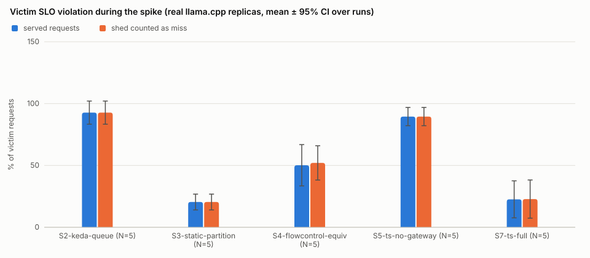
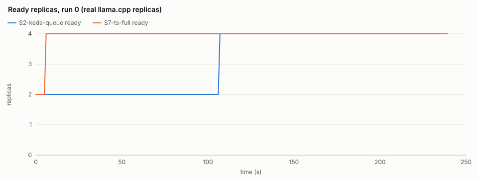
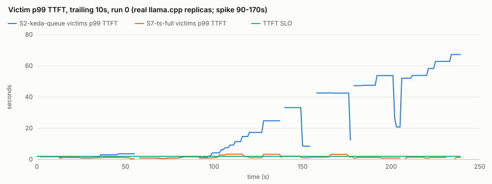

# Evaluation on real replicas

**REAL inference — llama.cpp b11898-8b28c2394, model qwen2.5-0.5b-instruct-q4_k_m.gguf, budget of 4 replicas x 2 threads (no GPU); replicas on CPUs 0-1 | 2-3 | 4-5 | 6-7 (one physical core each); gateway, controller and load generator on CPUs 8-15; no readiness hold (T = 0: replicas count as ready as soon as llama-server is); CPU Intel(R) Core(TM) i5-14450HX (16 logical CPUs), 2026-10-27**

Scenario `real`: 240 s; noisy tenant C spikes from 90 s to 170 s; victims A, B. Every setup replays the same trace in real time (seed 1..5 for run k = 0..4, the same for every setup), one setup at a time on a fresh pool: 2 replicas started and ready before traffic (the static partition: all 4), budget 4 replicas, 4 slots per replica, control cycle 10 s, 20s cooldown between runs. Every control loop makes its first sync a seeded delay in [0, cycle) after its stack starts (the same delay for every setup of a run index; listed per run below), so runs sample the phase of the control cycle relative to the spike. Latencies are measured by the load generator (wall clock, streaming).

## Main results (mean ± 95% CI over runs)

| metric | S2-keda-queue (N=5) | S3-static-partition (N=5) | S4-flowcontrol-equiv (N=5) | S5-ts-no-gateway (N=5) | S7-ts-full (N=5) |
| --- | --- | --- | --- | --- | --- |
| victim_violation_pct | 92.715 ± 9.370 | 20.440 ± 6.365 | 50.166 ± 16.670 | 89.522 ± 7.358 | 22.600 ± 14.937 |
| victim_shed_aware_violation_pct | 92.715 ± 9.370 | 20.440 ± 6.365 | 52.066 ± 13.859 | 89.522 ± 7.358 | 22.793 ± 15.448 |
| noisy_shed_pct | 0.000 ± 0.000 | 0.000 ± 0.000 | 53.148 ± 6.755 | 0.000 ± 0.000 | 42.873 ± 5.205 |
| reaction_time_s | 9.234 ± 4.162 | n/a | 25.226 ± 15.556 | 9.127 (n=1) | 9.217 ± 4.169 |
| replica_minutes | 12.673 ± 0.139 | 16.000 ± 0.000 | 10.920 ± 1.615 | 15.060 ± 0.657 | 15.070 ± 0.679 |
| jain_index | 0.656 ± 0.242 | 0.630 ± 0.061 | 0.938 ± 0.046 | 0.715 ± 0.236 | 0.961 ± 0.026 |
| max_counter_gap | n/a | n/a | n/a | n/a | 389.259 ± 268.170 |
| reclaim_latency_s | n/a | n/a | n/a | n/a | n/a |
| policy_latency_mean_ms | n/a | n/a | n/a | n/a | 0.209 ± 0.170 |
| p99_ttft_s_A | 64.385 ± 4.346 | 1.813 ± 0.504 | 5.043 ± 1.982 | 46.959 ± 11.065 | 2.789 ± 0.932 |
| p99_tpot_s_A | 0.170 ± 0.040 | 0.087 ± 0.040 | 0.153 ± 0.024 | 0.162 ± 0.023 | 0.143 ± 0.026 |
| p99_ttft_s_B | 64.662 ± 5.161 | 8.065 ± 3.090 | 8.040 ± 2.509 | 47.048 ± 13.374 | 5.235 ± 3.910 |
| p99_tpot_s_B | 0.153 ± 0.011 | 0.146 ± 0.032 | 0.148 ± 0.007 | 0.151 ± 0.016 | 0.149 ± 0.029 |
| p99_ttft_s_C | 65.649 ± 4.910 | 121.109 ± 0.190 | 14.454 ± 1.404 | 49.292 ± 11.675 | 11.512 ± 6.728 |
| p99_tpot_s_C | 0.171 ± 0.009 | 0.153 ± 0.016 | 0.160 ± 0.018 | 0.174 ± 0.018 | 0.165 ± 0.022 |
| completed | 421.600 ± 26.025 | 304.000 ± 16.332 | 267.800 ± 24.322 | 421.600 ± 26.025 | 298.600 ± 17.129 |
| shed | 0.000 ± 0.000 | 0.000 ± 0.000 | 153.800 ± 24.684 | 0.000 ± 0.000 | 123.000 ± 17.821 |
| failed | 0.000 ± 0.000 | 117.600 ± 15.696 | 0.000 ± 0.000 | 0.000 ± 0.000 | 0.000 ± 0.000 |

`victim_violation_pct`: share of the victims' requests arriving during the spike that missed their TTFT or TPOT SLO (shed requests excluded, failed ones count as misses); `victim_shed_aware_violation_pct` also counts shed requests as misses; `noisy_shed_pct`: share of the noisy tenant's requests rejected with 429; `reaction_time_s`: first protective action (scale-up or newly applied shedding) after the spike starts, which includes the wait for the next control cycle (its phase is sampled per run, see above); `replica_minutes`: integral of ready + starting replicas over the scenario; `jain_index`: Jain's fairness of SLO attainment / target during the spike; `max_counter_gap`: largest virtual-token-counter gap between backlogged tenants (fair gateway only); `policy_latency_mean_ms`: controller-to-gateway policy propagation; `p99_*`: per-tenant p99 over completed requests (seconds); n/a = not defined for that setup.

## Pre-registered claim: S7 vs S4 (README.md)

Victim (A, B) SLO attainment during C's spike = 100 - victim_violation_pct, paired by run index (same trace); no readiness hold (T = 0: replicas count as ready as soon as llama-server is). Decision rule: supported if the 95% CI of the mean paired difference S7 - S4 is wholly above 0.

| run | S7 attainment % | S4 attainment % | S7 - S4 | S7 shed-aware % | S4 shed-aware % | C shed % S7 | C shed % S4 | replica-min S7 | replica-min S4 |
| --- | --- | --- | --- | --- | --- | --- | --- | --- | --- |
| 0 | 82.222 | 46.667 | 35.556 | 82.222 | 46.667 | 43.446 | 50.562 | 15.833 | 12.333 |
| 1 | 88.571 | 71.875 | 16.696 | 88.571 | 65.714 | 35.689 | 46.643 | 15.000 | 10.200 |
| 2 | 56.897 | 37.931 | 18.966 | 55.932 | 37.288 | 45.238 | 51.020 | 15.183 | 12.333 |
| 3 | 80.000 | 40.909 | 39.091 | 80.000 | 40.000 | 43.624 | 59.732 | 14.300 | 9.734 |
| 4 | 79.310 | 51.786 | 27.525 | 79.310 | 50.000 | 46.367 | 57.785 | 15.033 | 10.000 |

Mean paired difference S7 - S4: **27.567 percentage points**, 95% CI [15.325, 39.808], N = 5 pairs. **Verdict: supported.**

## Setups

| setup | gateway | control plane |
| --- | --- | --- |
| S2-keda-queue | passthrough | KEDA (scalerun) on queued requests: waiting inside the replicas + gateway queue, 4 per replica |
| S3-static-partition | partition | none: pool fixed at capacity, guaranteed replicas as each tenant's slice |
| S4-flowcontrol-equiv | roundrobin | KEDA (scalerun) on the gateway queue length, 4 per replica |
| S5-ts-no-gateway | passthrough | TenantScaler controller, no gateway policy (coupling disabled) |
| S7-ts-full | fair | TenantScaler controller (arbiter + stabilizer) pushing policy to the fair gateway |

KEDA (S2/S4) uses the Kubernetes defaults of internal/autoscale: 4 queued requests per replica, activation 0, scale-down window 300 s, at most max(4, current) replicas added per sync.

## Runs

Every run, in the order it ran (`#` = sequence; `order` = position in its run index's seeded setup order, decision Q14). CPU % is the effective frequency as a percentage of nominal when traffic started and ended.

| # | setup | run | order | seed | victim violation % | victim shed-aware violation % | noisy shed % | requests | completed | shed | failed | failure causes | warm replicas | stack start s | control phase s | replicas started | mean cold start s | drain timed out | CPU % start/end | tokenizer fallbacks |
| --- | --- | --- | --- | --- | --- | --- | --- | --- | --- | --- | --- | --- | --- | --- | --- | --- | --- | --- | --- | --- |
| 1 | S2-keda-queue | 0 | 1 | 1 | 95.556 | 95.556 | 0.000 | 407 | 407 | 0 | 0 | - | 2 | 0.722 | 5.729 | 4 | 1.472 | false | 82.832 / 85.839 | 0 |
| 2 | S3-static-partition | 0 | 2 | 1 | 15.556 | 15.556 | 0.000 | 407 | 296 | 0 | 111 | http 503 Service Unavailable: 111 | 4 | 0.781 | - | 4 | 0.707 | false | 87.989 / 76.827 | 0 |
| 3 | S4-flowcontrol-equiv | 0 | 3 | 1 | 53.333 | 53.333 | 50.562 | 407 | 272 | 135 | 0 | - | 2 | 0.620 | 5.729 | 4 | 1.172 | false | 93.435 / 77.890 | 0 |
| 4 | S5-ts-no-gateway | 0 | 4 | 1 | 80.000 | 80.000 | 0.000 | 407 | 407 | 0 | 0 | - | 2 | 1.111 | 5.729 | 4 | 0.933 | false | 148.849 / 72.943 | 0 |
| 5 | S7-ts-full | 0 | 5 | 1 | 17.778 | 17.778 | 43.446 | 407 | 291 | 116 | 0 | - | 2 | 0.715 | 5.729 | 4 | 0.985 | false | 116.480 / 77.075 | 0 |
| 6 | S7-ts-full | 1 | 1 | 2 | 11.429 | 11.429 | 35.689 | 400 | 299 | 101 | 0 | - | 2 | 0.732 | 9.084 | 4 | 1.510 | false | 94.545 / 81.815 | 0 |
| 7 | S4-flowcontrol-equiv | 1 | 2 | 2 | 28.125 | 34.286 | 46.643 | 400 | 265 | 135 | 0 | - | 2 | 0.718 | 9.084 | 3 | 1.175 | false | 87.942 / 93.431 | 0 |
| 8 | S3-static-partition | 1 | 3 | 2 | 17.143 | 17.143 | 0.000 | 400 | 301 | 0 | 99 | http 503 Service Unavailable: 99 | 4 | 0.836 | - | 4 | 0.759 | false | 106.204 / 85.085 | 0 |
| 9 | S2-keda-queue | 1 | 4 | 2 | 80.000 | 80.000 | 0.000 | 400 | 400 | 0 | 0 | - | 2 | 0.774 | 9.084 | 4 | 1.485 | false | 88.541 / 80.560 | 0 |
| 10 | S5-ts-no-gateway | 1 | 5 | 2 | 91.429 | 91.429 | 0.000 | 400 | 400 | 0 | 0 | - | 2 | 0.667 | 9.084 | 4 | 1.446 | false | 102.509 / 84.635 | 0 |
| 11 | S7-ts-full | 2 | 1 | 3 | 43.103 | 44.068 | 45.238 | 449 | 315 | 134 | 0 | - | 2 | 0.615 | 0.128 | 4 | 1.158 | false | 100.211 / 100.726 | 0 |
| 12 | S4-flowcontrol-equiv | 2 | 2 | 3 | 62.069 | 62.712 | 51.020 | 449 | 298 | 151 | 0 | - | 2 | 0.718 | 0.128 | 4 | 1.470 | false | 106.534 / 94.716 | 0 |
| 13 | S5-ts-no-gateway | 2 | 3 | 3 | 94.915 | 94.915 | 0.000 | 449 | 449 | 0 | 0 | - | 2 | 0.766 | 0.128 | 4 | 1.510 | false | 88.297 / 76.317 | 0 |
| 14 | S3-static-partition | 2 | 4 | 3 | 28.814 | 28.814 | 0.000 | 449 | 325 | 0 | 124 | http 503 Service Unavailable: 124 | 4 | 0.836 | - | 4 | 0.759 | false | 98.388 / 96.677 | 0 |
| 15 | S2-keda-queue | 2 | 5 | 3 | 94.915 | 94.915 | 0.000 | 449 | 449 | 0 | 0 | - | 2 | 0.664 | 0.128 | 4 | 0.895 | false | 76.284 / 101.075 | 0 |
| 16 | S4-flowcontrol-equiv | 3 | 1 | 4 | 59.091 | 60.000 | 59.732 | 438 | 259 | 179 | 0 | - | 2 | 0.661 | 6.552 | 3 | 1.122 | false | 82.507 / 106.392 | 0 |
| 17 | S7-ts-full | 3 | 2 | 4 | 20.000 | 20.000 | 43.624 | 438 | 308 | 130 | 0 | - | 2 | 0.720 | 6.552 | 4 | 1.396 | false | 78.087 / 114.687 | 0 |
| 18 | S2-keda-queue | 3 | 3 | 4 | 100.000 | 100.000 | 0.000 | 438 | 438 | 0 | 0 | - | 2 | 0.611 | 6.552 | 4 | 1.382 | false | 72.582 / 143.713 | 0 |
| 19 | S5-ts-no-gateway | 3 | 4 | 4 | 93.333 | 93.333 | 0.000 | 438 | 438 | 0 | 0 | - | 2 | 0.877 | 6.552 | 4 | 1.498 | false | 125.069 / 102.973 | 0 |
| 20 | S3-static-partition | 3 | 5 | 4 | 20.000 | 20.000 | 0.000 | 438 | 307 | 0 | 131 | http 503 Service Unavailable: 131 | 4 | 0.786 | - | 4 | 0.734 | false | 65.511 / 78.269 | 0 |
| 21 | S7-ts-full | 4 | 1 | 5 | 20.690 | 20.690 | 46.367 | 414 | 280 | 134 | 0 | - | 2 | 0.719 | 0.241 | 5 | 1.588 | false | 69.874 / 141.238 | 0 |
| 22 | S3-static-partition | 4 | 2 | 5 | 20.690 | 20.690 | 0.000 | 414 | 291 | 0 | 123 | http 503 Service Unavailable: 123 | 4 | 0.839 | - | 4 | 0.785 | false | 67.168 / 109.731 | 0 |
| 23 | S2-keda-queue | 4 | 3 | 5 | 93.103 | 93.103 | 0.000 | 414 | 414 | 0 | 0 | - | 2 | 0.664 | 0.241 | 4 | 1.395 | false | 67.419 / 73.665 | 0 |
| 24 | S4-flowcontrol-equiv | 4 | 4 | 5 | 48.214 | 50.000 | 57.785 | 414 | 245 | 169 | 0 | - | 2 | 0.617 | 0.241 | 3 | 1.109 | false | 67.465 / 77.769 | 0 |
| 25 | S5-ts-no-gateway | 4 | 5 | 5 | 87.931 | 87.931 | 0.000 | 414 | 414 | 0 | 0 | - | 2 | 0.660 | 0.241 | 5 | 1.567 | false | 65.319 / 75.283 | 0 |

## Drift check (first vs last run of each setup)

Each setup's first and last run (by sequence) on the main metric and the CPU frequency. They use different seeds (different traces), so a change here mixes drift and trace; a change in the same direction for every setup points to drift of the machine.

| setup | first run (#) | last run (#) | victim violation % first | last | change | CPU % first | CPU % last |
| --- | --- | --- | --- | --- | --- | --- | --- |
| S2-keda-queue | run 0 (#1) | run 4 (#23) | 95.556 | 93.103 | -2.452 | 82.832 | 67.419 |
| S3-static-partition | run 0 (#2) | run 4 (#22) | 15.556 | 20.690 | 5.134 | 87.989 | 67.168 |
| S4-flowcontrol-equiv | run 0 (#3) | run 4 (#24) | 53.333 | 48.214 | -5.119 | 93.435 | 67.465 |
| S5-ts-no-gateway | run 0 (#4) | run 4 (#25) | 80.000 | 87.931 | 7.931 | 148.849 | 65.319 |
| S7-ts-full | run 0 (#5) | run 4 (#21) | 17.778 | 20.690 | 2.912 | 116.480 | 69.874 |

Per-run raw data: `records/<setup>-run<k>.csv` (one row per request), `timeline/<setup>-run<k>.csv` (1 s samples), `decisions/<setup>-run<k>.jsonl` (controller setups: every decision with its reason); all metrics per run in `runs.csv`, everything in `summary.json`.

## What was NOT measured

- Setups S1-cpu-hpa, S6-ts-no-borrowing, S7F-ts-full-forecast, S8-ts-naive-demand, S4b-flowcontrol-outstanding, S7nr-ts-no-reservation: not part of these real runs; the SIMULATED evaluation (`tenantscaler experiment`) covers every setup.
- CPU temperature: not readable without administrator rights (the ACPI thermal zones Windows exposes are not CPU sensors); the CPU's effective frequency is logged per run instead.
- GPU inference: replicas run on CPU cores only (backend.llama.gpuLayers 0, enforced; PLAN.md decision Q8); a GPU pool would behave differently.
- Cold-start sensitivity: the replicas' cold start was not varied (mean 1.210 s over the 99 replicas the runs started); the cold-start sweep exists only in the simulated evaluation.
- Kubernetes: the pool is a local process manager, not a Deployment; KEDA and the controller act on it directly.
- The demand forecaster (S7F) is off in every real setup.
- Isolation of the measurement: the load generator, gateway and controller share this machine with the replicas (they are not pinned; replicas are).
- Tokens: the gateway and controller count prompt words, the replica's tokenizer counts tokens (see results/real/profile.md for the ratio).
- Reclaim latency: the scenario has no returning owner (n/a).
- Per-tenant queues inside the replicas: with the passthrough gateway, requests waiting inside a replica count as in flight in the timeline (replicas do not report their queue per tenant).
