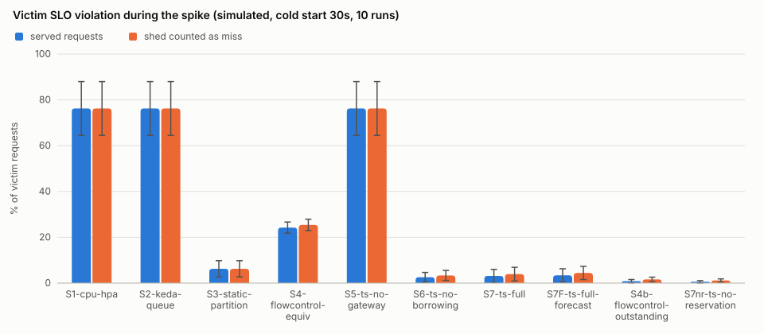
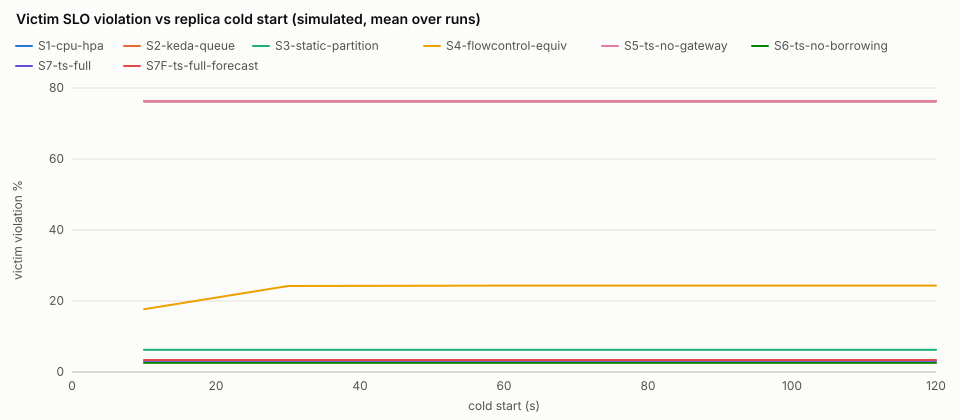
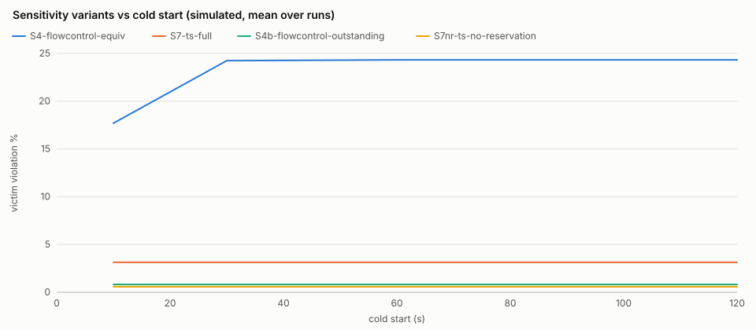
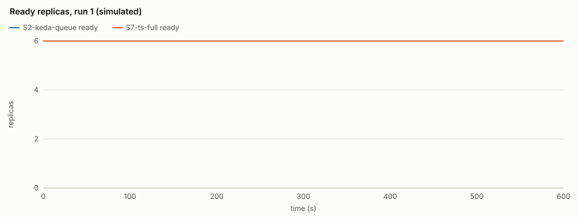
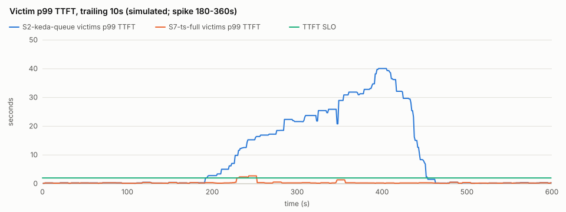

# TenantScaler evaluation (simulated)

> **SIMULATED: these numbers come from the discrete-event simulator (internal/sim), which runs the real fairq gateway scheduler, control.Core controller and autoscale HPA/KEDA code in virtual time, with replica compute replaced by the simulated engine latency model (the config's engine parameters: illustrative unless calibrated by `tenantscaler profile`; not measured inference). Real-replica results are reported separately.**

Scenario `default` (600s): noisy tenant **C** spikes during [180s, 360s); victims A, B. 10 runs per setup and cold start with seeds [1 2 3 4 5 6 7 8 9 10] (the same seeds, hence the same request traces, for every setup). Budget 6 replicas; every scaling setup starts with 6 warm replicas, the static partition with all 6.

## Setups

| setup | gateway | control plane |
| --- | --- | --- |
| S1-cpu-hpa | passthrough | CPU-style HPA on engine slot occupancy (target 0.7) |
| S2-keda-queue | passthrough | KEDA on total queued requests (4 per replica) |
| S3-static-partition | partition | none: pool fixed at capacity, guarantees as shares |
| S4-flowcontrol-equiv | roundrobin | KEDA on the gateway queue length (4 per replica) |
| S5-ts-no-gateway | passthrough | TenantScaler controller, no gateway policy |
| S6-ts-no-borrowing | fair | TenantScaler controller without borrowing |
| S7-ts-full | fair | TenantScaler controller |
| S7F-ts-full-forecast | fair | TenantScaler controller + Holt-Winters forecaster |
| S4b-flowcontrol-outstanding | roundrobin | sensitivity variant of S4: KEDA on outstanding requests, gateway queue + dispatched (4 per replica) |
| S7nr-ts-no-reservation | fair | sensitivity variant of S7: TenantScaler controller without slot reservation |

## Main results (cold start 30s; mean ± 95% CI over runs, t-distribution)

`runs` is N; a cell marked `(n=k)` is defined in only k runs, `n/a` in none. Percentages are 0-100, times in seconds.

| metric | S1-cpu-hpa | S2-keda-queue | S3-static-partition | S4-flowcontrol-equiv | S5-ts-no-gateway | S6-ts-no-borrowing | S7-ts-full | S7F-ts-full-forecast | S4b-flowcontrol-outstanding | S7nr-ts-no-reservation |
| --- | --- | --- | --- | --- | --- | --- | --- | --- | --- | --- |
| runs | 10 | 10 | 10 | 10 | 10 | 10 | 10 | 10 | 10 | 10 |
| victim_violation_pct | 76.262 ± 11.739 | 76.262 ± 11.739 | 6.249 ± 3.531 | 24.239 ± 2.429 | 76.262 ± 11.739 | 2.583 ± 2.078 | 3.129 ± 2.892 | 3.394 ± 2.847 | 0.819 ± 0.727 | 0.584 ± 0.497 |
| victim_shed_aware_violation_pct | 76.262 ± 11.739 | 76.262 ± 11.739 | 6.249 ± 3.531 | 25.423 ± 2.494 | 76.262 ± 11.739 | 3.349 ± 2.215 | 3.934 ± 2.992 | 4.436 ± 2.890 | 1.641 ± 0.981 | 1.151 ± 0.696 |
| noisy_shed_pct | 0.000 ± 0.000 | 0.000 ± 0.000 | 0.000 ± 0.000 | 24.347 ± 2.562 | 0.000 ± 0.000 | 30.758 ± 2.292 | 29.591 ± 2.303 | 29.967 ± 2.312 | 15.696 ± 3.039 | 15.709 ± 3.088 |
| reaction_time_s | n/a | n/a | n/a | 150.000 ± 0.000 | n/a | 60.020 ± 70.817 | 36.020 ± 55.226 | 34.520 ± 51.845 | n/a | 36.020 ± 55.226 |
| replica_minutes | 60.000 ± 0.000 | 60.000 ± 0.000 | 60.000 ± 0.000 | 59.368 ± 0.071 | 60.000 ± 0.000 | 60.000 ± 0.000 | 60.000 ± 0.000 | 60.000 ± 0.000 | 60.000 ± 0.000 | 60.000 ± 0.000 |
| jain_index | 0.978 ± 0.028 | 0.978 ± 0.028 | 0.678 ± 0.005 | 0.992 ± 0.004 | 0.978 ± 0.028 | 0.998 ± 0.001 | 0.998 ± 0.002 | 0.998 ± 0.002 | 1.000 ± 0.000 | 1.000 ± 0.000 |
| max_counter_gap | n/a | n/a | n/a | n/a | n/a | 976.677 ± 391.153 | 1119.389 ± 501.437 | 1134.225 ± 538.442 | n/a | 387.667 ± 95.700 |
| reclaim_latency_s | n/a | n/a | n/a | n/a | n/a | n/a | n/a | n/a | n/a | n/a |
| policy_latency_mean_ms | n/a | n/a | n/a | n/a | n/a | 20.000 ± 0.000 | 20.000 ± 0.000 | 20.000 ± 0.000 | n/a | 20.000 ± 0.000 |
| p99_ttft_s_A | 26.538 ± 7.597 | 26.538 ± 7.597 | 0.353 ± 0.039 | 29.174 ± 4.197 | 26.538 ± 7.597 | 0.394 ± 0.048 | 0.391 ± 0.044 | 0.401 ± 0.060 | 0.876 ± 0.189 | 0.836 ± 0.172 |
| p99_tpot_s_A | 0.055 ± 0.000 | 0.055 ± 0.000 | 0.046 ± 0.002 | 0.054 ± 0.000 | 0.055 ± 0.000 | 0.048 ± 0.001 | 0.049 ± 0.002 | 0.049 ± 0.002 | 0.053 ± 0.000 | 0.054 ± 0.000 |
| p99_ttft_s_B | 28.241 ± 7.879 | 28.241 ± 7.879 | 4.534 ± 1.207 | 28.537 ± 3.990 | 28.241 ± 7.879 | 2.335 ± 0.837 | 2.465 ± 0.917 | 2.635 ± 0.850 | 1.423 ± 0.421 | 1.330 ± 0.375 |
| p99_tpot_s_B | 0.055 ± 0.000 | 0.055 ± 0.000 | 0.054 ± 0.000 | 0.054 ± 0.000 | 0.055 ± 0.000 | 0.049 ± 0.001 | 0.050 ± 0.001 | 0.049 ± 0.001 | 0.054 ± 0.000 | 0.054 ± 0.000 |
| p99_ttft_s_C | 28.559 ± 7.522 | 28.559 ± 7.522 | 120.184 ± 0.024 | 33.182 ± 4.987 | 28.559 ± 7.522 | 4.372 ± 1.030 | 4.146 ± 0.920 | 4.183 ± 0.909 | 1.298 ± 0.370 | 1.676 ± 0.595 |
| p99_tpot_s_C | 0.055 ± 0.000 | 0.055 ± 0.000 | 0.056 ± 0.000 | 0.054 ± 0.000 | 0.055 ± 0.000 | 0.049 ± 0.002 | 0.051 ± 0.001 | 0.051 ± 0.001 | 0.054 ± 0.000 | 0.054 ± 0.000 |
| completed | 2684.000 ± 85.892 | 2684.000 ± 85.892 | 2435.500 ± 47.252 | 2348.500 ± 50.070 | 2684.000 ± 85.892 | 2267.100 ± 51.470 | 2282.300 ± 48.403 | 2276.400 ± 52.433 | 2468.400 ± 51.298 | 2469.200 ± 51.161 |
| shed | 0.000 ± 0.000 | 0.000 ± 0.000 | 0.000 ± 0.000 | 335.500 ± 45.420 | 0.000 ± 0.000 | 416.900 ± 46.757 | 401.700 ± 46.176 | 407.600 ± 44.768 | 215.600 ± 47.553 | 214.800 ± 47.996 |
| failed | 0.000 ± 0.000 | 0.000 ± 0.000 | 248.500 ± 47.204 | 0.000 ± 0.000 | 0.000 ± 0.000 | 0.000 ± 0.000 | 0.000 ± 0.000 | 0.000 ± 0.000 | 0.000 ± 0.000 | 0.000 ± 0.000 |

Metric notes: `victim_violation_pct` = victims' requests arriving in the spike window that missed the TTFT/TPOT SLO (shed requests excluded); `victim_shed_aware_violation_pct` counts shed victim requests as misses; `noisy_shed_pct` = noisy tenant's requests shed over the run; `reaction_time_s` = first protective action (scale-up or shedding policy) after the spike starts; `replica_minutes` = GPU-holding replicas integrated over the scenario; `jain_index` = Jain's fairness of SLO attainment during the spike; `max_counter_gap` = largest VTC counter gap among backlogged tenants (fair gateway only; n/a when the gateway never had a backlog); `reclaim_latency_s` applies to the reclaim scenario only.

Weighted-VTC ordering decides dispatch order only while requests queue at the fair gateway. Runs with such a backlog (max_counter_gap defined): S6-ts-no-borrowing 10/10, S7-ts-full 10/10, S7F-ts-full-forecast 10/10, S7nr-ts-no-reservation 10/10. In the other runs the fair setups' results reflect shedding, least-loaded dispatch and scaling, not VTC fairness.

## Cold-start sweep: victim SLO violation % during the spike (mean ± 95% CI)

| setup | cold start 10s | cold start 30s | cold start 60s | cold start 120s |
| --- | --- | --- | --- | --- |
| S1-cpu-hpa | 76.262 ± 11.739 | 76.262 ± 11.739 | 76.262 ± 11.739 | 76.262 ± 11.739 |
| S2-keda-queue | 76.262 ± 11.739 | 76.262 ± 11.739 | 76.262 ± 11.739 | 76.262 ± 11.739 |
| S3-static-partition | 6.249 ± 3.531 | 6.249 ± 3.531 | 6.249 ± 3.531 | 6.249 ± 3.531 |
| S4-flowcontrol-equiv | 17.696 ± 3.883 | 24.239 ± 2.429 | 24.327 ± 2.454 | 24.327 ± 2.454 |
| S5-ts-no-gateway | 76.262 ± 11.739 | 76.262 ± 11.739 | 76.262 ± 11.739 | 76.262 ± 11.739 |
| S6-ts-no-borrowing | 2.583 ± 2.078 | 2.583 ± 2.078 | 2.583 ± 2.078 | 2.583 ± 2.078 |
| S7-ts-full | 3.129 ± 2.892 | 3.129 ± 2.892 | 3.129 ± 2.892 | 3.129 ± 2.892 |
| S7F-ts-full-forecast | 3.394 ± 2.847 | 3.394 ± 2.847 | 3.394 ± 2.847 | 3.394 ± 2.847 |
| S4b-flowcontrol-outstanding | 0.819 ± 0.727 | 0.819 ± 0.727 | 0.819 ± 0.727 | 0.819 ± 0.727 |
| S7nr-ts-no-reservation | 0.584 ± 0.497 | 0.584 ± 0.497 | 0.584 ± 0.497 | 0.584 ± 0.497 |

## Plots (simulated)

## Parameters

- Tenants: A guaranteed 2, max 8, priority 100, SLO TTFT 2s / TPOT 100ms / 99%; B guaranteed 2, max 8, priority 100, SLO TTFT 2s / TPOT 100ms / 99%; C guaranteed 2, max 8, priority 100, SLO TTFT 2s / TPOT 100ms / 99%
- Pool: capacity 6, min 1, dispatch window 8 per replica.
- Controller (S5-S7F): cycle 15s, headroom 0.2, C = 400 weighted tokens/s per replica, scale-down window 120s, max step 4, Retry-After 2s.
- S7F forecaster: Holt-Winters alpha 0.5, beta 0.1, gamma 0.3, bucket 15s, season 8 buckets (fixed a priori).
- Baselines: HPA target utilisation 0.7 (engine slot occupancy as the CPU proxy, averaged over the cycle), KEDA 4 requests per replica (queued for S2 and S4, outstanding for S4b); tolerance 0.1; scale-down window 300s; both synced every control cycle and capped at the budget.
- Simulated engine: prefill 40ms + 200µs/token, inter-token 25ms, 8 concurrent sequences, prefill x2 and decode x2 at full load, jitter 0.05.
- Policy propagation delay 20ms (simulated); gateway dispatch timeout 120s (a request still queued at the gateway then fails, like the live gateway's 503); timeline every 1s; unfinished requests fail 300s after the scenario ends.

## Threats to validity

- The engine is simulated: latencies follow an illustrative load model, with the load fixed at each request's start.
- Shed and timed-out requests are not retried; real clients would retry after Retry-After and add load.
- Policy propagation is a constant delay; the live controller-to-gateway push has variable latency.
- The CPU-style HPA uses engine slot occupancy as its CPU proxy.
- S4, the closest related-work baseline, is weak by construction. As DESIGN section 14 specifies, its KEDA trigger is the roundrobin gateway's queue. That queue excludes the up to `slotsPerReplica` requests per replica already dispatched, and the gateway sheds sheddable overflow as `saturated` instead of queueing it, so the queue reads about zero while the pool is saturated and S4 can scale down in the middle of a spike once its scale-down window expires. The sensitivity variant `S4b-flowcontrol-outstanding` (same gateway, KEDA on gateway queue + dispatched requests; included by `-setups all`) shows how much of S4's result comes from that metric: compare TenantScaler with it, not only with S4.
- How much the gateway matters depends on whether the replica budget binds. C (`tenantscaler profile`) is measured on ONE replica; a pool of replicas sustains more per replica (multiplexing over all slots), so a budget sized by C can still absorb a spike once enough replicas are up, and then setups that scale up early look alike for the victims. Rerun with `-capacity` (for example `-capacity 6`; tenant guarantees are scaled down to fit) to evaluate a binding budget.
