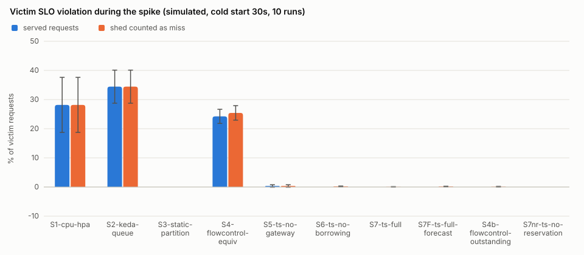
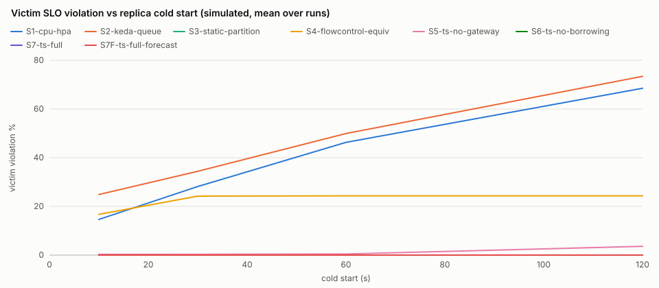
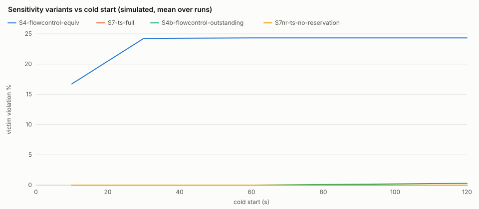
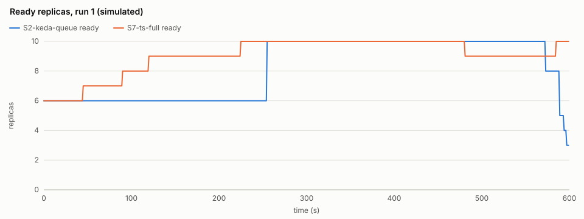
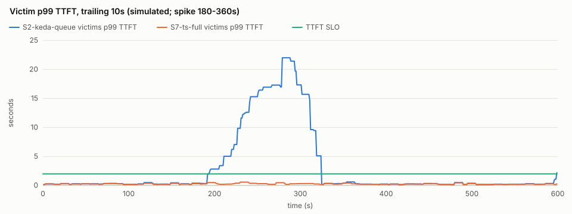

# TenantScaler evaluation (simulated)

> **SIMULATED: these numbers come from the discrete-event simulator (internal/sim), which runs the real fairq gateway scheduler, control.Core controller and autoscale HPA/KEDA code in virtual time, with replica compute replaced by the simulated engine latency model (the config's engine parameters: illustrative unless calibrated by `tenantscaler profile`; not measured inference). Real-replica results are reported separately.**

Scenario `default` (600s): noisy tenant **C** spikes during [180s, 360s); victims A, B. 10 runs per setup and cold start with seeds [1 2 3 4 5 6 7 8 9 10] (the same seeds, hence the same request traces, for every setup). Budget 10 replicas; every scaling setup starts with 6 warm replicas, the static partition with all 10.

## Setups

| setup | gateway | control plane |
| --- | --- | --- |
| S1-cpu-hpa | passthrough | CPU-style HPA on engine slot occupancy (target 0.7) |
| S2-keda-queue | passthrough | KEDA on total queued requests (4 per replica) |
| S3-static-partition | partition | none: pool fixed at capacity, guarantees as shares |
| S4-flowcontrol-equiv | roundrobin | KEDA on the gateway queue length (4 per replica) |
| S5-ts-no-gateway | passthrough | TenantScaler controller, no gateway policy |
| S6-ts-no-borrowing | fair | TenantScaler controller without borrowing |
| S7-ts-full | fair | TenantScaler controller |
| S7F-ts-full-forecast | fair | TenantScaler controller + Holt-Winters forecaster |
| S4b-flowcontrol-outstanding | roundrobin | sensitivity variant of S4: KEDA on outstanding requests, gateway queue + dispatched (4 per replica) |
| S7nr-ts-no-reservation | fair | sensitivity variant of S7: TenantScaler controller without slot reservation |

## Main results (cold start 30s; mean ± 95% CI over runs, t-distribution)

`runs` is N; a cell marked `(n=k)` is defined in only k runs, `n/a` in none. Percentages are 0-100, times in seconds.

| metric | S1-cpu-hpa | S2-keda-queue | S3-static-partition | S4-flowcontrol-equiv | S5-ts-no-gateway | S6-ts-no-borrowing | S7-ts-full | S7F-ts-full-forecast | S4b-flowcontrol-outstanding | S7nr-ts-no-reservation |
| --- | --- | --- | --- | --- | --- | --- | --- | --- | --- | --- |
| runs | 10 | 10 | 10 | 10 | 10 | 10 | 10 | 10 | 10 | 10 |
| victim_violation_pct | 28.176 ± 9.451 | 34.430 ± 5.676 | 0.000 ± 0.000 | 24.239 ± 2.429 | 0.345 ± 0.432 | 0.000 ± 0.000 | 0.000 ± 0.000 | 0.000 ± 0.000 | 0.000 ± 0.000 | 0.000 ± 0.000 |
| victim_shed_aware_violation_pct | 28.176 ± 9.451 | 34.430 ± 5.676 | 0.000 ± 0.000 | 25.423 ± 2.494 | 0.345 ± 0.432 | 0.215 ± 0.123 | 0.047 ± 0.071 | 0.165 ± 0.113 | 0.092 ± 0.112 | 0.000 ± 0.000 |
| noisy_shed_pct | 0.000 ± 0.000 | 0.000 ± 0.000 | 0.000 ± 0.000 | 23.856 ± 2.512 | 0.000 ± 0.000 | 14.946 ± 2.478 | 3.792 ± 1.738 | 4.904 ± 1.797 | 2.189 ± 1.565 | 0.164 ± 0.224 |
| reaction_time_s | 27.000 ± 6.786 | 49.500 ± 8.834 | n/a | 150.000 ± 0.000 | 190.000 ± 204.195 (n=6) | 13.520 ± 3.393 | 15.014 ± 0.007 | 15.014 ± 0.007 | 20.625 ± 13.301 (n=8) | 15.014 ± 0.007 |
| replica_minutes | 84.450 ± 0.846 | 80.073 ± 3.973 | 100.000 ± 0.000 | 76.368 ± 0.071 | 94.107 ± 1.210 | 83.563 ± 1.396 | 94.123 ± 1.212 | 95.125 ± 0.955 | 88.675 ± 1.855 | 94.112 ± 1.209 |
| jain_index | 0.996 ± 0.004 | 0.997 ± 0.004 | 0.704 ± 0.011 | 0.992 ± 0.004 | 1.000 ± 0.000 | 1.000 ± 0.000 | 1.000 ± 0.000 | 1.000 ± 0.000 | 1.000 ± 0.000 | 1.000 ± 0.000 |
| max_counter_gap | n/a | n/a | n/a | n/a | n/a | 0.000 ± 0.000 | 0.000 ± 0.000 | 0.000 ± 0.000 | n/a | 0.000 (n=1) |
| reclaim_latency_s | n/a | n/a | n/a | n/a | n/a | n/a | n/a | n/a | n/a | n/a |
| policy_latency_mean_ms | n/a | n/a | n/a | n/a | n/a | 20.000 ± 0.000 | 20.000 ± 0.000 | 20.000 ± 0.000 | n/a | 20.000 ± 0.000 |
| p99_ttft_s_A | 9.603 ± 3.607 | 21.106 ± 8.522 | 0.274 ± 0.011 | 29.174 ± 4.197 | 0.463 ± 0.174 | 0.317 ± 0.016 | 0.317 ± 0.016 | 0.316 ± 0.017 | 0.402 ± 0.070 | 0.312 ± 0.012 |
| p99_tpot_s_A | 0.053 ± 0.001 | 0.054 ± 0.000 | 0.034 ± 0.000 | 0.054 ± 0.000 | 0.049 ± 0.001 | 0.043 ± 0.001 | 0.044 ± 0.001 | 0.044 ± 0.001 | 0.049 ± 0.002 | 0.046 ± 0.002 |
| p99_ttft_s_B | 10.230 ± 3.942 | 25.309 ± 11.907 | 0.337 ± 0.031 | 28.537 ± 3.990 | 0.630 ± 0.341 | 0.324 ± 0.015 | 0.324 ± 0.014 | 0.318 ± 0.014 | 0.402 ± 0.071 | 0.331 ± 0.015 |
| p99_tpot_s_B | 0.054 ± 0.000 | 0.054 ± 0.000 | 0.048 ± 0.002 | 0.054 ± 0.000 | 0.050 ± 0.002 | 0.044 ± 0.001 | 0.045 ± 0.002 | 0.045 ± 0.002 | 0.051 ± 0.002 | 0.047 ± 0.002 |
| p99_ttft_s_C | 11.252 ± 4.204 | 16.636 ± 5.127 | 94.181 ± 11.817 | 33.161 ± 4.970 | 0.936 ± 0.483 | 1.539 ± 0.307 | 0.619 ± 0.204 | 0.725 ± 0.237 | 0.545 ± 0.225 | 0.366 ± 0.016 |
| p99_tpot_s_C | 0.055 ± 0.000 | 0.055 ± 0.000 | 0.056 ± 0.000 | 0.054 ± 0.000 | 0.052 ± 0.001 | 0.045 ± 0.001 | 0.046 ± 0.001 | 0.046 ± 0.002 | 0.052 ± 0.001 | 0.048 ± 0.002 |
| completed | 2684.000 ± 85.892 | 2684.000 ± 85.892 | 2680.100 ± 81.264 | 2355.600 ± 52.265 | 2684.000 ± 85.892 | 2481.100 ± 53.550 | 2632.100 ± 71.822 | 2617.100 ± 74.588 | 2654.900 ± 87.513 | 2681.700 ± 84.439 |
| shed | 0.000 ± 0.000 | 0.000 ± 0.000 | 0.000 ± 0.000 | 328.400 ± 43.729 | 0.000 ± 0.000 | 202.900 ± 39.677 | 51.900 ± 23.794 | 66.900 ± 24.396 | 29.100 ± 21.015 | 2.300 ± 3.128 |
| failed | 0.000 ± 0.000 | 0.000 ± 0.000 | 3.900 ± 8.822 | 0.000 ± 0.000 | 0.000 ± 0.000 | 0.000 ± 0.000 | 0.000 ± 0.000 | 0.000 ± 0.000 | 0.000 ± 0.000 | 0.000 ± 0.000 |

Metric notes: `victim_violation_pct` = victims' requests arriving in the spike window that missed the TTFT/TPOT SLO (shed requests excluded); `victim_shed_aware_violation_pct` counts shed victim requests as misses; `noisy_shed_pct` = noisy tenant's requests shed over the run; `reaction_time_s` = first protective action (scale-up or shedding policy) after the spike starts; `replica_minutes` = GPU-holding replicas integrated over the scenario; `jain_index` = Jain's fairness of SLO attainment during the spike; `max_counter_gap` = largest VTC counter gap among backlogged tenants (fair gateway only; n/a when the gateway never had a backlog); `reclaim_latency_s` applies to the reclaim scenario only.

Weighted-VTC ordering decides dispatch order only while requests queue at the fair gateway. Runs with such a backlog (max_counter_gap defined): S6-ts-no-borrowing 10/10, S7-ts-full 10/10, S7F-ts-full-forecast 10/10, S7nr-ts-no-reservation 1/10. In the other runs the fair setups' results reflect shedding, least-loaded dispatch and scaling, not VTC fairness.

## Cold-start sweep: victim SLO violation % during the spike (mean ± 95% CI)

| setup | cold start 10s | cold start 30s | cold start 60s | cold start 120s |
| --- | --- | --- | --- | --- |
| S1-cpu-hpa | 14.657 ± 7.054 | 28.176 ± 9.451 | 46.311 ± 12.171 | 68.536 ± 12.237 |
| S2-keda-queue | 24.870 ± 3.516 | 34.430 ± 5.676 | 49.957 ± 8.753 | 73.447 ± 10.163 |
| S3-static-partition | 0.000 ± 0.000 | 0.000 ± 0.000 | 0.000 ± 0.000 | 0.000 ± 0.000 |
| S4-flowcontrol-equiv | 16.726 ± 3.162 | 24.239 ± 2.429 | 24.327 ± 2.454 | 24.327 ± 2.454 |
| S5-ts-no-gateway | 0.298 ± 0.444 | 0.345 ± 0.432 | 0.459 ± 0.423 | 3.606 ± 3.653 |
| S6-ts-no-borrowing | 0.000 ± 0.000 | 0.000 ± 0.000 | 0.000 ± 0.000 | 0.000 ± 0.000 |
| S7-ts-full | 0.000 ± 0.000 | 0.000 ± 0.000 | 0.000 ± 0.000 | 0.000 ± 0.000 |
| S7F-ts-full-forecast | 0.000 ± 0.000 | 0.000 ± 0.000 | 0.000 ± 0.000 | 0.000 ± 0.000 |
| S4b-flowcontrol-outstanding | 0.000 ± 0.000 | 0.000 ± 0.000 | 0.000 ± 0.000 | 0.293 ± 0.299 |
| S7nr-ts-no-reservation | 0.000 ± 0.000 | 0.000 ± 0.000 | 0.000 ± 0.000 | 0.000 ± 0.000 |

## Plots (simulated)

## Parameters

- Tenants: A guaranteed 3, max 8, priority 100, SLO TTFT 2s / TPOT 100ms / 99%; B guaranteed 3, max 8, priority 100, SLO TTFT 2s / TPOT 100ms / 99%; C guaranteed 3, max 8, priority 100, SLO TTFT 2s / TPOT 100ms / 99%
- Pool: capacity 10, min 1, dispatch window 8 per replica.
- Controller (S5-S7F): cycle 15s, headroom 0.2, C = 400 weighted tokens/s per replica, scale-down window 120s, max step 4, Retry-After 2s.
- S7F forecaster: Holt-Winters alpha 0.5, beta 0.1, gamma 0.3, bucket 15s, season 8 buckets (fixed a priori).
- Baselines: HPA target utilisation 0.7 (engine slot occupancy as the CPU proxy, averaged over the cycle), KEDA 4 requests per replica (queued for S2 and S4, outstanding for S4b); tolerance 0.1; scale-down window 300s; both synced every control cycle and capped at the budget.
- Simulated engine: prefill 40ms + 200µs/token, inter-token 25ms, 8 concurrent sequences, prefill x2 and decode x2 at full load, jitter 0.05.
- Policy propagation delay 20ms (simulated); gateway dispatch timeout 120s (a request still queued at the gateway then fails, like the live gateway's 503); timeline every 1s; unfinished requests fail 300s after the scenario ends.

## Threats to validity

- The engine is simulated: latencies follow an illustrative load model, with the load fixed at each request's start.
- Shed and timed-out requests are not retried; real clients would retry after Retry-After and add load.
- Policy propagation is a constant delay; the live controller-to-gateway push has variable latency.
- The CPU-style HPA uses engine slot occupancy as its CPU proxy.
- S4, the closest related-work baseline, is weak by construction. As DESIGN section 14 specifies, its KEDA trigger is the roundrobin gateway's queue. That queue excludes the up to `slotsPerReplica` requests per replica already dispatched, and the gateway sheds sheddable overflow as `saturated` instead of queueing it, so the queue reads about zero while the pool is saturated and S4 can scale down in the middle of a spike once its scale-down window expires. The sensitivity variant `S4b-flowcontrol-outstanding` (same gateway, KEDA on gateway queue + dispatched requests; included by `-setups all`) shows how much of S4's result comes from that metric: compare TenantScaler with it, not only with S4.
- How much the gateway matters depends on whether the replica budget binds. C (`tenantscaler profile`) is measured on ONE replica; a pool of replicas sustains more per replica (multiplexing over all slots), so a budget sized by C can still absorb a spike once enough replicas are up, and then setups that scale up early look alike for the victims. Rerun with `-capacity` (for example `-capacity 6`; tenant guarantees are scaled down to fit) to evaluate a binding budget.
