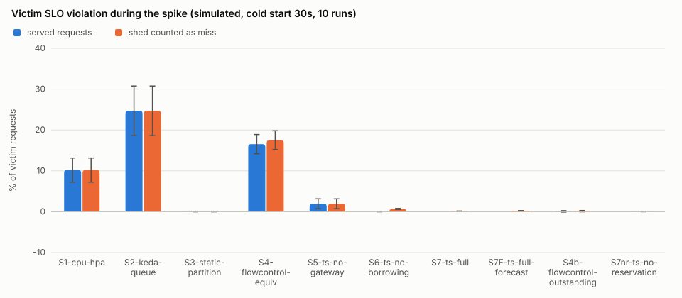
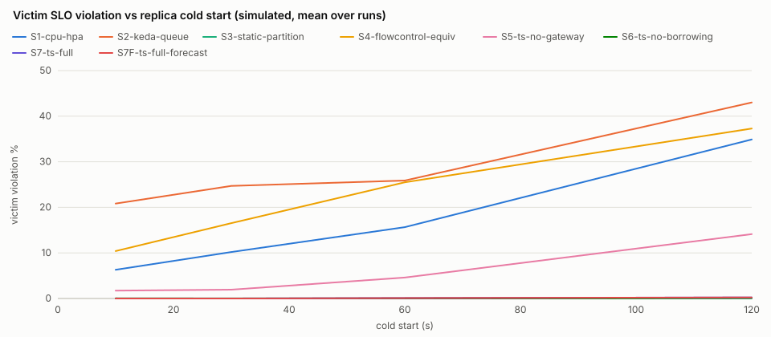
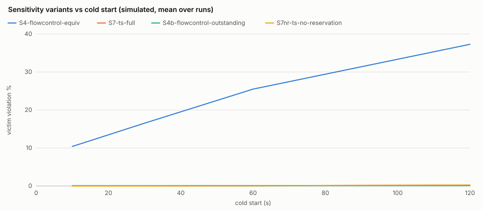
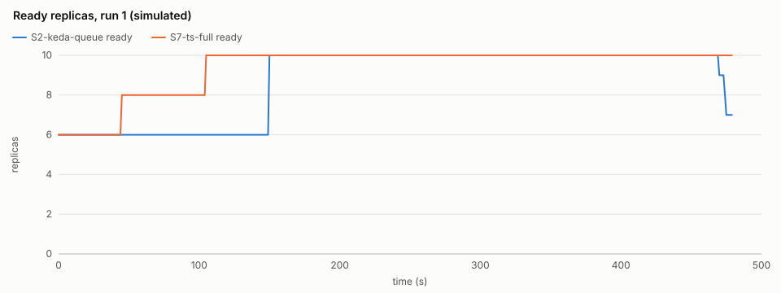
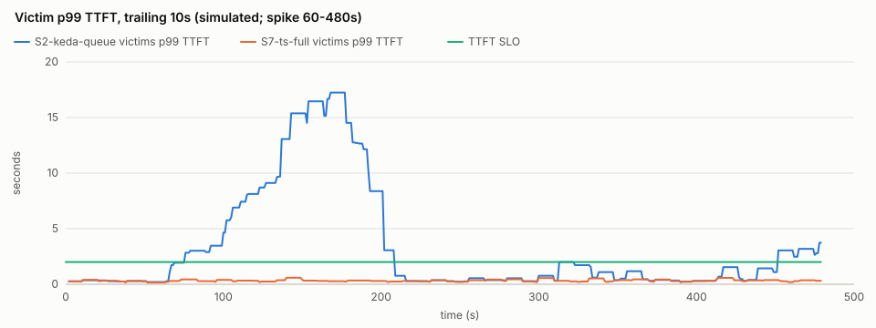

# TenantScaler evaluation (simulated)

> **SIMULATED: these numbers come from the discrete-event simulator (internal/sim), which runs the real fairq gateway scheduler, control.Core controller and autoscale HPA/KEDA code in virtual time, with replica compute replaced by the simulated engine latency model (the config's engine parameters: illustrative unless calibrated by `tenantscaler profile`; not measured inference). Real-replica results are reported separately.**

Scenario `reclaim` (480s): noisy tenant **C** spikes during [60s, 480s); victims A, B. 10 runs per setup and cold start with seeds [1 2 3 4 5 6 7 8 9 10] (the same seeds, hence the same request traces, for every setup). Budget 10 replicas; every scaling setup starts with 6 warm replicas, the static partition with all 10.

## Setups

| setup | gateway | control plane |
| --- | --- | --- |
| S1-cpu-hpa | passthrough | CPU-style HPA on engine slot occupancy (target 0.7) |
| S2-keda-queue | passthrough | KEDA on total queued requests (4 per replica) |
| S3-static-partition | partition | none: pool fixed at capacity, guarantees as shares |
| S4-flowcontrol-equiv | roundrobin | KEDA on the gateway queue length (4 per replica) |
| S5-ts-no-gateway | passthrough | TenantScaler controller, no gateway policy |
| S6-ts-no-borrowing | fair | TenantScaler controller without borrowing |
| S7-ts-full | fair | TenantScaler controller |
| S7F-ts-full-forecast | fair | TenantScaler controller + Holt-Winters forecaster |
| S4b-flowcontrol-outstanding | roundrobin | sensitivity variant of S4: KEDA on outstanding requests, gateway queue + dispatched (4 per replica) |
| S7nr-ts-no-reservation | fair | sensitivity variant of S7: TenantScaler controller without slot reservation |

## Main results (cold start 30s; mean ± 95% CI over runs, t-distribution)

`runs` is N; a cell marked `(n=k)` is defined in only k runs, `n/a` in none. Percentages are 0-100, times in seconds.

| metric | S1-cpu-hpa | S2-keda-queue | S3-static-partition | S4-flowcontrol-equiv | S5-ts-no-gateway | S6-ts-no-borrowing | S7-ts-full | S7F-ts-full-forecast | S4b-flowcontrol-outstanding | S7nr-ts-no-reservation |
| --- | --- | --- | --- | --- | --- | --- | --- | --- | --- | --- |
| runs | 10 | 10 | 10 | 10 | 10 | 10 | 10 | 10 | 10 | 10 |
| victim_violation_pct | 10.186 ± 2.959 | 24.700 ± 6.071 | 0.033 ± 0.058 | 16.534 ± 2.359 | 1.941 ± 1.209 | 0.008 ± 0.019 | 0.000 ± 0.000 | 0.000 ± 0.000 | 0.084 ± 0.169 | 0.000 ± 0.000 |
| victim_shed_aware_violation_pct | 10.186 ± 2.959 | 24.700 ± 6.071 | 0.033 ± 0.058 | 17.515 ± 2.286 | 1.941 ± 1.209 | 0.673 ± 0.121 | 0.101 ± 0.073 | 0.170 ± 0.105 | 0.142 ± 0.160 | 0.017 ± 0.025 |
| noisy_shed_pct | 0.000 ± 0.000 | 0.000 ± 0.000 | 0.000 ± 0.000 | 28.912 ± 3.453 | 0.000 ± 0.000 | 24.917 ± 1.617 | 8.526 ± 1.461 | 8.915 ± 1.364 | 2.435 ± 0.629 | 0.678 ± 0.440 |
| reaction_time_s | 28.500 ± 3.393 | 48.000 ± 15.835 | n/a | 275.000 ± 11.530 (n=9) | 13.500 ± 3.393 | 13.516 ± 3.392 | 13.500 ± 3.393 | 13.500 ± 3.393 | 15.000 ± 0.000 | 13.500 ± 3.393 |
| replica_minutes | 71.850 ± 0.796 | 68.890 ± 1.980 | 80.000 ± 0.000 | 54.675 ± 3.062 | 76.925 ± 0.499 | 62.450 ± 0.452 | 76.925 ± 0.499 | 76.925 ± 0.499 | 74.975 ± 0.057 | 76.925 ± 0.499 |
| jain_index | 0.997 ± 0.002 | 0.995 ± 0.003 | 0.681 ± 0.003 | 0.994 ± 0.002 | 1.000 ± 0.000 | 1.000 ± 0.000 | 1.000 ± 0.000 | 1.000 ± 0.000 | 1.000 ± 0.000 | 1.000 ± 0.000 |
| max_counter_gap | n/a | n/a | n/a | n/a | n/a | 528.995 ± 446.650 | 18.582 ± 41.778 | 18.582 ± 41.778 | n/a | 64.746 ± 108.080 (n=7) |
| reclaim_latency_s | 55.885 ± 31.694 | 73.502 ± 37.425 | 0.000 ± 0.000 | 107.244 ± 26.960 | 52.939 ± 33.705 | 0.000 ± 0.000 | 0.000 ± 0.000 | 0.000 ± 0.000 | 0.000 ± 0.000 | 0.000 ± 0.000 |
| policy_latency_mean_ms | n/a | n/a | n/a | n/a | n/a | 20.000 ± 0.000 | 20.000 ± 0.000 | 20.000 ± 0.000 | n/a | 20.000 ± 0.000 |
| p99_ttft_s_A | 3.402 ± 1.002 | 17.203 ± 9.876 | 0.290 ± 0.010 | 26.125 ± 8.689 | 2.568 ± 0.865 | 0.404 ± 0.028 | 0.389 ± 0.033 | 0.387 ± 0.033 | 0.432 ± 0.045 | 0.427 ± 0.033 |
| p99_tpot_s_A | 0.054 ± 0.001 | 0.055 ± 0.000 | 0.036 ± 0.001 | 0.056 ± 0.001 | 0.054 ± 0.000 | 0.051 ± 0.001 | 0.047 ± 0.001 | 0.047 ± 0.001 | 0.051 ± 0.001 | 0.052 ± 0.001 |
| p99_ttft_s_B | 9.047 ± 3.034 | 19.358 ± 7.670 | 0.553 ± 0.154 | 25.795 ± 7.899 | 2.337 ± 0.625 | 0.581 ± 0.169 | 0.410 ± 0.034 | 0.416 ± 0.037 | 0.671 ± 0.215 | 0.420 ± 0.035 |
| p99_tpot_s_B | 0.055 ± 0.000 | 0.055 ± 0.000 | 0.051 ± 0.001 | 0.055 ± 0.000 | 0.054 ± 0.000 | 0.052 ± 0.001 | 0.048 ± 0.001 | 0.048 ± 0.001 | 0.053 ± 0.000 | 0.051 ± 0.001 |
| p99_ttft_s_C | 9.157 ± 3.106 | 19.792 ± 7.759 | 120.209 ± 0.025 | 19.338 ± 6.535 | 2.513 ± 0.553 | 2.170 ± 0.338 | 0.960 ± 0.136 | 0.989 ± 0.135 | 0.485 ± 0.042 | 0.417 ± 0.017 |
| p99_tpot_s_C | 0.055 ± 0.000 | 0.055 ± 0.000 | 0.056 ± 0.000 | 0.055 ± 0.000 | 0.054 ± 0.000 | 0.051 ± 0.001 | 0.048 ± 0.001 | 0.048 ± 0.001 | 0.053 ± 0.001 | 0.052 ± 0.001 |
| completed | 3505.600 ± 65.441 | 3505.600 ± 65.441 | 3145.200 ± 48.597 | 2858.900 ± 76.399 | 3505.600 ± 65.441 | 2952.200 ± 46.695 | 3316.800 ± 50.356 | 3307.600 ± 52.095 | 3451.300 ± 57.367 | 3490.200 ± 59.010 |
| shed | 0.000 ± 0.000 | 0.000 ± 0.000 | 0.000 ± 0.000 | 646.700 ± 87.958 | 0.000 ± 0.000 | 553.400 ± 51.107 | 188.800 ± 39.263 | 198.000 ± 37.666 | 54.300 ± 15.013 | 15.400 ± 10.230 |
| failed | 0.000 ± 0.000 | 0.000 ± 0.000 | 360.400 ± 72.033 | 0.000 ± 0.000 | 0.000 ± 0.000 | 0.000 ± 0.000 | 0.000 ± 0.000 | 0.000 ± 0.000 | 0.000 ± 0.000 | 0.000 ± 0.000 |

Metric notes: `victim_violation_pct` = victims' requests arriving in the spike window that missed the TTFT/TPOT SLO (shed requests excluded); `victim_shed_aware_violation_pct` counts shed victim requests as misses; `noisy_shed_pct` = noisy tenant's requests shed over the run; `reaction_time_s` = first protective action (scale-up or shedding policy) after the spike starts; `replica_minutes` = GPU-holding replicas integrated over the scenario; `jain_index` = Jain's fairness of SLO attainment during the spike; `max_counter_gap` = largest VTC counter gap among backlogged tenants (fair gateway only; n/a when the gateway never had a backlog); `reclaim_latency_s` applies to the reclaim scenario only.

Weighted-VTC ordering decides dispatch order only while requests queue at the fair gateway. Runs with such a backlog (max_counter_gap defined): S6-ts-no-borrowing 10/10, S7-ts-full 10/10, S7F-ts-full-forecast 10/10, S7nr-ts-no-reservation 7/10. In the other runs the fair setups' results reflect shedding, least-loaded dispatch and scaling, not VTC fairness.

## Cold-start sweep: victim SLO violation % during the spike (mean ± 95% CI)

| setup | cold start 10s | cold start 30s | cold start 60s | cold start 120s |
| --- | --- | --- | --- | --- |
| S1-cpu-hpa | 6.297 ± 1.981 | 10.186 ± 2.959 | 15.650 ± 4.750 | 34.899 ± 9.640 |
| S2-keda-queue | 20.826 ± 4.027 | 24.700 ± 6.071 | 25.888 ± 8.777 | 43.008 ± 7.276 |
| S3-static-partition | 0.033 ± 0.058 | 0.033 ± 0.058 | 0.033 ± 0.058 | 0.033 ± 0.058 |
| S4-flowcontrol-equiv | 10.412 ± 1.706 | 16.534 ± 2.359 | 25.494 ± 4.216 | 37.295 ± 6.798 |
| S5-ts-no-gateway | 1.723 ± 1.211 | 1.941 ± 1.209 | 4.600 ± 2.521 | 14.126 ± 4.875 |
| S6-ts-no-borrowing | 0.017 ± 0.038 | 0.008 ± 0.019 | 0.008 ± 0.019 | 0.101 ± 0.131 |
| S7-ts-full | 0.000 ± 0.000 | 0.000 ± 0.000 | 0.086 ± 0.100 | 0.234 ± 0.199 |
| S7F-ts-full-forecast | 0.000 ± 0.000 | 0.000 ± 0.000 | 0.086 ± 0.100 | 0.234 ± 0.199 |
| S4b-flowcontrol-outstanding | 0.075 ± 0.170 | 0.084 ± 0.169 | 0.084 ± 0.169 | 0.102 ± 0.170 |
| S7nr-ts-no-reservation | 0.000 ± 0.000 | 0.000 ± 0.000 | 0.086 ± 0.100 | 0.218 ± 0.200 |

## Plots (simulated)

## Parameters

- Tenants: A guaranteed 3, max 8, priority 100, SLO TTFT 2s / TPOT 100ms / 99%; B guaranteed 3, max 8, priority 100, SLO TTFT 2s / TPOT 100ms / 99%; C guaranteed 3, max 8, priority 100, SLO TTFT 2s / TPOT 100ms / 99%
- Pool: capacity 10, min 1, dispatch window 8 per replica.
- Controller (S5-S7F): cycle 15s, headroom 0.2, C = 400 weighted tokens/s per replica, scale-down window 120s, max step 4, Retry-After 2s.
- S7F forecaster: Holt-Winters alpha 0.5, beta 0.1, gamma 0.3, bucket 15s, season 8 buckets (fixed a priori).
- Baselines: HPA target utilisation 0.7 (engine slot occupancy as the CPU proxy, averaged over the cycle), KEDA 4 requests per replica (queued for S2 and S4, outstanding for S4b); tolerance 0.1; scale-down window 300s; both synced every control cycle and capped at the budget.
- Simulated engine: prefill 40ms + 200µs/token, inter-token 25ms, 8 concurrent sequences, prefill x2 and decode x2 at full load, jitter 0.05.
- Policy propagation delay 20ms (simulated); gateway dispatch timeout 120s (a request still queued at the gateway then fails, like the live gateway's 503); timeline every 1s; unfinished requests fail 300s after the scenario ends.

## Threats to validity

- The engine is simulated: latencies follow an illustrative load model, with the load fixed at each request's start.
- Shed and timed-out requests are not retried; real clients would retry after Retry-After and add load.
- Policy propagation is a constant delay; the live controller-to-gateway push has variable latency.
- The CPU-style HPA uses engine slot occupancy as its CPU proxy.
- S4, the closest related-work baseline, is weak by construction. As DESIGN section 14 specifies, its KEDA trigger is the roundrobin gateway's queue. That queue excludes the up to `slotsPerReplica` requests per replica already dispatched, and the gateway sheds sheddable overflow as `saturated` instead of queueing it, so the queue reads about zero while the pool is saturated and S4 can scale down in the middle of a spike once its scale-down window expires. The sensitivity variant `S4b-flowcontrol-outstanding` (same gateway, KEDA on gateway queue + dispatched requests; included by `-setups all`) shows how much of S4's result comes from that metric: compare TenantScaler with it, not only with S4.
- How much the gateway matters depends on whether the replica budget binds. C (`tenantscaler profile`) is measured on ONE replica; a pool of replicas sustains more per replica (multiplexing over all slots), so a budget sized by C can still absorb a spike once enough replicas are up, and then setups that scale up early look alike for the victims. Rerun with `-capacity` (for example `-capacity 6`; tenant guarantees are scaled down to fit) to evaluate a binding budget.
